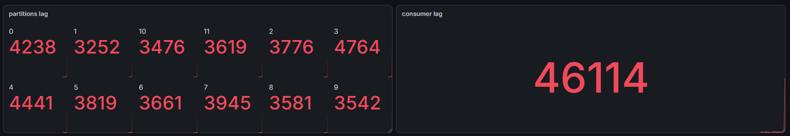
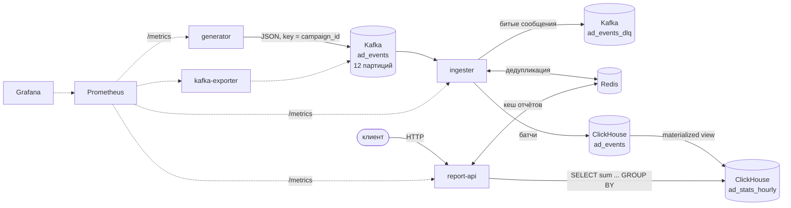
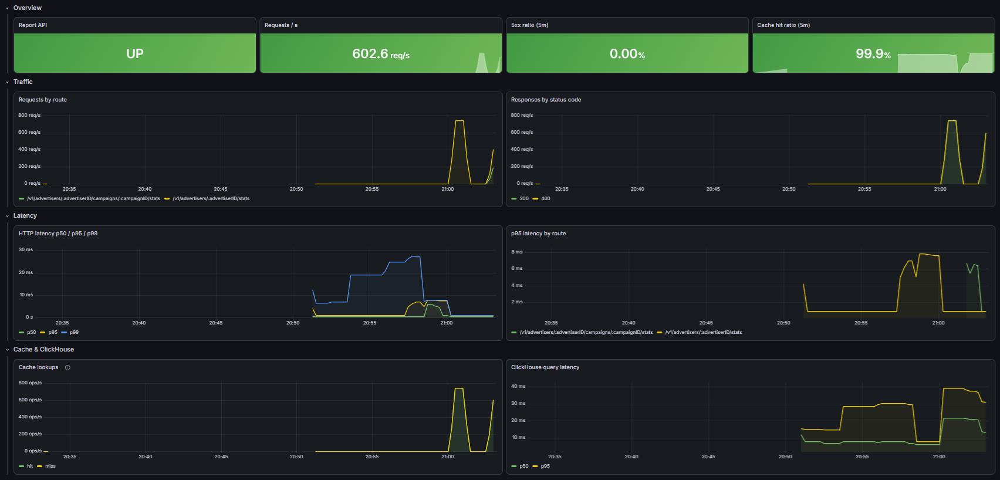

# ads_stats_service

[](https://github.com/zeroqual/ads_stats_service/actions/workflows/ci.yml)


Сервис статистики рекламных событий: принимает поток показов и кликов из Kafka, надёжно складывает его в ClickHouse и отдаёт агрегированную статистику по рекламодателям и кампаниям через HTTP API.

Проект сделан как приближенный к продакшену pipeline: гарантия **at-least-once** без потерь при падениях, **дедупликация**, **DLQ** для битых сообщений, **метрики, дашборды и алерты**, тесты и CI.

<!-- Добавьте скриншоты в docs/images/ — они показываются здесь -->


## Возможности

- **Ingestion без потерь.** Offset в Kafka коммитится только после успешной вставки в ClickHouse. Ctrl+C, падение ClickHouse и ребалансировка консьюмер-группы не теряют данные.
- **Батчевая вставка.** Пачка уходит в ClickHouse по размеру (`BATCH_SIZE`) или по таймеру (`BATCH_FLUSH_INTERVAL`), с ретраями и экспоненциальным backoff.
- **Дедупликация.** Повторы по `event_id` отсекаются внутри пачки и через Redis до вставки, поэтому агрегаты не завышаются.
- **Dead Letter Queue.** Невалидные сообщения уходят в отдельный топик с причиной в заголовках и не блокируют поток.
- **Предагрегация.** Materialized view считает почасовую статистику на лету, API читает компактную таблицу агрегатов, а не сырые события.
- **Report API** на Gin: статистика по рекламодателю и кампании за период, разбивка по часам или дням, кеш в Redis.
- **Наблюдаемость.** Prometheus-метрики всех сервисов, lag консьюмера через kafka-exporter, два дашборда Grafana, алерты.

## Архитектура



| Сервис | Что делает |
|---|---|
| `generator` | Генерирует показы и клики с заданным RPS, долей кликов и долей дублей. Ключ сообщения — `campaign_id`, поэтому события одной кампании попадают в одну партицию. |
| `ingester` | Читает `ad_events` в консьюмер-группе, валидирует, дедуплицирует, пишет пачками в ClickHouse и коммитит offset после вставки. |
| `report-api` | HTTP API статистики из `ad_stats_hourly` с кешем в Redis. |
| `migrate` | Одноразовый контейнер: накатывает миграции ClickHouse через goose. |
| `kafka-init` | Одноразовый контейнер: создаёт топики. |

## Стек

| | |
|---|---|
| Язык | Go 1.27, `log/slog` |
| Очередь | Apache Kafka 4 (KRaft), [franz-go](https://github.com/twmb/franz-go) |
| Хранилище | ClickHouse (ReplacingMergeTree, SummingMergeTree, materialized view), [clickhouse-go](https://github.com/ClickHouse/clickhouse-go) |
| Кеш и дедупликация | Redis, [go-redis](https://github.com/redis/go-redis) |
| HTTP | [Gin](https://github.com/gin-gonic/gin) |
| Миграции | [goose](https://github.com/pressly/goose) |
| Наблюдаемость | Prometheus, Grafana, kafka-exporter |
| Инфраструктура | Docker, Docker Compose, GitHub Actions, golangci-lint |

## Быстрый старт

Нужен только Docker.

```bash
git clone https://github.com/zeroqual/ads_stats_service.git
cd ads_stats_service
cp .env.example .env
docker compose up -d --build
```

Compose поднимет инфраструктуру, дождётся healthcheck'ов, создаст топики, накатит миграции и запустит сервисы. Через минуту данные уже идут.

| Что | Адрес |
|---|---|
| Report API | http://localhost:8080 |
| Grafana | http://localhost:3000 (`admin` / `admin`), папка **ADS** |
| Prometheus | http://localhost:9090 (вкладка **Alerts**) |
| ClickHouse HTTP | http://localhost:8123 |

Остановить: `docker compose down`. Удалить вместе с данными: `docker compose down -v`.

Масштабировать ingester (партиции перераспределятся между экземплярами автоматически):

```bash
docker compose up -d --scale ingester=3
```

## API

| Метод | Путь | Описание |
|---|---|---|
| `GET` | `/v1/advertisers/{advertiserID}/stats` | Статистика по всем кампаниям рекламодателя |
| `GET` | `/v1/advertisers/{advertiserID}/campaigns/{campaignID}/stats` | Статистика по кампании |
| `GET` | `/healthz` | Liveness: процесс жив |
| `GET` | `/readyz` | Readiness: ClickHouse доступен, иначе `503` |
| `GET` | `/metrics` | Метрики Prometheus |

Параметры запроса:

| Параметр | По умолчанию | Описание |
|---|---|---|
| `from`, `to` | последние 24 часа | Границы периода в RFC3339, `[from, to)` |
| `granularity` | `hour` | `hour` (период до 31 дня) или `day` (до 366 дней) |

```bash
curl -i "http://localhost:8080/v1/advertisers/1/campaigns/101/stats?granularity=hour&from=2026-11-16T00:00:00Z&to=2026-11-17T00:00:00Z"
```

```json
{
  "advertiser_id": 1,
  "campaign_id": 101,
  "from": "2026-11-16T00:00:00Z",
  "to": "2026-11-17T00:00:00Z",
  "granularity": "hour",
  "totals": { "impressions": 86400, "clicks": 1728, "cost_micros": 38880000000, "ctr": 0.02 },
  "points": [
    { "ts": "2026-11-16T00:00:00Z", "impressions": 3600, "clicks": 72, "cost_micros": 1620000000 }
  ]
}
```

- Деньги хранятся и отдаются в `cost_micros` (1 ₽ = 1 000 000), целыми числами: без ошибок округления `float`.
- `totals` равен сумме всех `points`. CTR считается на сервере, при нуле показов он равен `0`.
- Заголовок `X-Cache: HIT | MISS` показывает, пришёл ответ из кеша или из ClickHouse.
- Ошибки валидации — `400 {"error": "..."}`. Внутренние ошибки — `500` без подробностей наружу, детали в логах.

## Ключевые решения

### Гарантия доставки: at-least-once

Автокоммит offset'ов в Kafka выключен. Ingester складывает события в буфер и коммитит **только после того, как вставка в ClickHouse подтверждена**. Отсюда инвариант всего ingester'а: *если буфер пуст — всё прочитанное уже сохранено, и коммитить безопасно.*

- **Падение ClickHouse.** Вставка ретраится с экспоненциальным backoff, новые события не читаются, lag растёт, коммитов нет. После восстановления буфер вставляется, и ingester догоняет.
- **Ctrl+C / SIGTERM.** Ingester дописывает буфер с отдельным контекстом и только потом коммитит. Вставка запускается с `context.WithoutCancel`, чтобы сигнал не оборвал INSERT на середине: иначе неизвестно, дошла ли пачка.
- **Ребалансировка.** С `BlockRebalanceOnPoll` партиции не отбираются, пока в буфере лежат их незакоммиченные события. Ребалансировка разрешается только при пустом буфере.

### Дедупликация: «проверить → вставить → пометить»

Источник дублей — повторные отправки и перечитывание после падения. Порядок в `flush`:

1. убрать повторы внутри пачки;
2. `MGET` в Redis: выкинуть уже виденные `event_id`;
3. вставить в ClickHouse;
4. `SET dedup:<id> EX 1h` для вставленных (pipeline, один сетевой запрос);
5. закоммитить offset.

Почему **не** «пометить, потом вставить»: при падении между этими шагами событие было бы помечено, но не вставлено, и после рестарта его отбросили бы как дубль. Это потеря. В выбранном порядке худший случай — дубль в окне между шагами 3 и 4, а не потеря.

Если Redis недоступен — **fail-open**: дедупликация пропускается, поток не останавливается. В сырой таблице повторы со временем схлопнет ReplacingMergeTree.

### Схема ClickHouse

```
ad_events        ReplacingMergeTree(inserted_at)
                 PARTITION BY toYYYYMMDD(event_time)
                 ORDER BY (advertiser_id, campaign_id, event_time, event_id)
                 TTL 30 дней

ad_stats_hourly  SummingMergeTree
                 PARTITION BY toYYYYMM(hour)
                 ORDER BY (advertiser_id, campaign_id, ad_id, hour)

ad_stats_hourly_mv  MATERIALIZED VIEW ... TO ad_stats_hourly
```

- **`ORDER BY` начинается с `advertiser_id, campaign_id`,** потому что все отчёты строятся «по клиенту или кампании за период», а разреженный индекс ClickHouse работает по префиксу ключа. По той же причине в API кампания вложена в рекламодателя: `/advertisers/{id}/campaigns/{id}`.
- **`event_id` в ключе сортировки** нужен ReplacingMergeTree, чтобы схлопывать именно повторы одного события.
- **Materialized view — это триггер на INSERT,** он видит только вставляемый блок. Дубль, дошедший до вставки, попадает в агрегаты навсегда. Поэтому дедупликация сделана **до** вставки, а не возложена на ReplacingMergeTree.
- **Слияния SummingMergeTree происходят в фоне,** поэтому API всегда читает через `sum() ... GROUP BY`.
- Сырые события живут 30 дней, агрегаты хранятся бессрочно.

### Битые сообщения → DLQ

Сообщение, которое не разбирается как JSON или не проходит валидацию (пустой `event_id`, неизвестный тип, отрицательная стоимость и т. п.), отправляется в `ad_events_dlq` **в исходном виде**. Причина и источник лежат в заголовках `errors`, `source_partition`, `source_offset`. Коммит происходит только после того, как и хорошие события вставлены, и плохие отправлены в DLQ.

### Кеш отчётов

Cache-aside в Redis с коротким TTL (30 с): данные обновляются каждую секунду, и кеш защищает ClickHouse от одинаковых запросов подряд. Ключ содержит версию формата (`stats:v1:...`). При недоступном Redis API работает напрямую с ClickHouse.

## Наблюдаемость

**Метрики:**

| Сервис | Метрики |
|---|---|
| generator | `ads_generator_sent_total`, `ads_generator_send_errors_total` |
| ingester | `ads_ingester_consumed_total`, `_inserted_total`, `_insert_errors_total`, `_dedup_dropped_total`, `_dlq_total`, `_insert_duration_seconds`, `_batch_size`, `_buffered` |
| report-api | `ads_api_requests_total{method,route,code}`, `ads_api_request_duration_seconds{method,route}`, `ads_api_cache_requests_total{result}`, `ads_api_clickhouse_query_duration_seconds` |
| kafka-exporter | `kafka_consumergroup_lag{consumergroup,topic,partition}` |

Метка `route` — это шаблон маршрута (`/v1/advertisers/:advertiserID/stats`), а не фактический путь: так число рядов не растёт с количеством рекламодателей.

**Дашборды** (поднимаются автоматически через provisioning):

- **ADS pipeline**: пропускная способность генератора и ingester'а, lag (общий и по партициям), p95/p99 вставки, размер пачки, доля дублей, ошибки и DLQ, заполненность буфера.
- **ADS Report API**: RPS по маршрутам, коды ответов, доля 5xx, p50/p95/p99, hit ratio кеша, латентность запросов в ClickHouse, статус сервисов.



**Алерты** (`deploy/prometheus/alerts.yml`):

| Алерт | Условие |
|---|---|
| `IngesterDown` | нет ни одного работающего ingester'а 30 с |
| `KafkaLagHigh` | суммарный lag группы > 2000 сообщений 1 мин |
| `InsertErrors` | ошибки вставки в ClickHouse держатся 1 мин |
| `DLQNotEmpty` | за 5 минут в DLQ появились сообщения |
| `ReportAPIDown` | report-api не отвечает 30 с |
| `ReportAPIErrors` | report-api отдаёт 5xx 1 мин |

## Проверено руками

- **1000 событий/с,** 12 партиций, lag в норме — десятки сообщений на партицию.
- **Остановка ClickHouse под нагрузкой и Ctrl+C ingester'а.** После восстановления в ClickHouse ровно столько событий, сколько в Kafka (313 000 из 313 000), без потерь и без дублей. Алерты `InsertErrors` и `KafkaLagHigh` срабатывают и гаснут после восстановления.
- **5% дублей от генератора.** Ingester отсекает около 4.8% прочитанного, доля дублей в агрегатах — 0.
- **Два ingester'а в одной группе** делят 12 партиций 6/6. При остановке одного все партиции переходят к оставшемуся меньше чем за секунду.

## Тесты

```bash
go test -race ./...
```

- **`internal/ingester`** — 12 тестов на фейках источника, хранилища, дедупера и DLQ. Проверяют порядок операций по журналу:
  - коммит никогда не идёт раньше успешной вставки или отправки в DLQ;
  - события, пришедшие одновременно с отменой контекста, не теряются;
  - флаш по размеру и по времени;
  - ретраи;
  - дубли внутри пачки и между пачками;
  - fail-open при недоступном Redis.
- **`internal/api`** — 11 тестов через `httptest`:
  - валидация параметров;
  - итоги и CTR;
  - пустой период;
  - кеш hit/miss;
  - fail-open кеша;
  - `500` без утечки деталей;
  - `/readyz` и `/healthz`.

CI (GitHub Actions) на каждый push и PR: `go mod tidy`-проверка, `go vet`, тесты с `-race`, golangci-lint. Затем сборка четырёх образов (`generator`, `ingester`, `report-api`, `migrate`) из одного multi-stage Dockerfile; на `main` образы публикуются в GitHub Container Registry.

## Конфигурация

Все настройки — через переменные окружения (см. [`.env.example`](.env.example)). При запуске в Docker адреса Kafka, ClickHouse и Redis переопределяются на внутренние в `docker-compose.yaml`.

| Переменная | По умолчанию | |
|---|---|---|
| `GEN_RPS` | `1000` | событий в секунду |
| `GEN_CAMPAIGNS` / `GEN_ADVERTISERS` | `1000` / `100` | кардинальность |
| `GEN_CLICK_RATE` | `0.02` | доля кликов |
| `GEN_DUPLICATE_RATE` | `0` | доля повторно отправляемых событий |
| `BATCH_SIZE` | `5000` | максимальный размер пачки |
| `BATCH_FLUSH_INTERVAL` | `1s` | максимальное время жизни пачки |
| `DEDUP_TTL` | `1h` | окно дедупликации |
| `CACHE_TTL` | `30s` | TTL кеша отчётов, `0` — без кеша |
| `QUERY_TIMEOUT` | `5s` | таймаут запроса в ClickHouse из API |
| `LOG_LEVEL` | `info` | `debug` / `info` / `warn` / `error` |

## Структура проекта

```
cmd/
  generator/      точка входа генератора
  ingester/       точка входа ingester'а
  report-api/     точка входа API
internal/
  api/            хендлеры Gin, сервис отчётов, middleware, метрики API
  cache/          кеш отчётов в Redis
  config/         загрузка и валидация конфигурации из env
  dedup/          дедупликация через Redis
  event/          модель события и валидация
  generator/      генерация событий
  ingester/       батчинг, ретраи, коммиты — ядро pipeline
  kafka/          consumer и producer на franz-go
  metrics/        метрики generator и ingester
  storage/        ClickHouse: вставка событий и запросы статистики
migrations/       миграции ClickHouse (goose)
deploy/
  prometheus/     конфиг и алерты
  grafana/        provisioning и дашборды
```

## Локальная разработка

Инфраструктура в Docker, сервисы — из IDE:

```bash
docker compose up -d kafka kafka-init clickhouse migrate redis
go run ./cmd/ingester
go run ./cmd/generator
go run ./cmd/report-api
```

Prometheus в compose собирает метрики с контейнеров сервисов. Чтобы видеть на дашбордах сервисы, запущенные через `go run`, замените цели в `deploy/prometheus/prometheus.yml` на `host.docker.internal:<порт>`.

## Что можно улучшить

- **Горячие партиции.** Если одна кампания даёт непропорционально много трафика, её партиция становится узким местом. Решение — salting ключа (`campaign_id:N`) для горячих кампаний ценой потери порядка внутри кампании.
- **Интеграционные тесты** на testcontainers-go с настоящими Kafka, ClickHouse и Redis: сценарий «kill посреди потока → сверка счётчиков» автоматически, а не руками.
- **Закрыть окно дублей** между вставкой и пометкой в Redis через `insert_deduplication_token` ClickHouse.
- **Singleflight** в API, чтобы одновременные одинаковые запросы при пустом кеше шли в ClickHouse один раз.
- Аутентификация API и проверка, что рекламодатель запрашивает только свои кампании.
